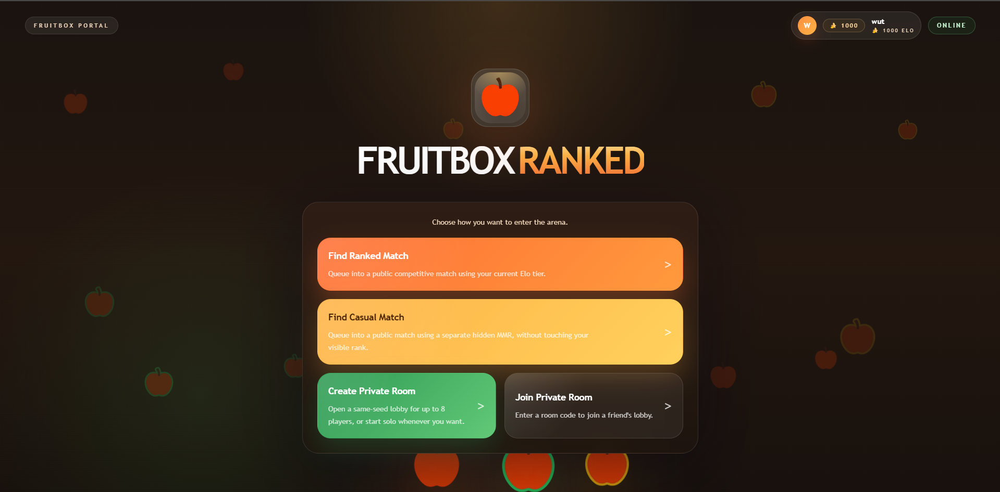
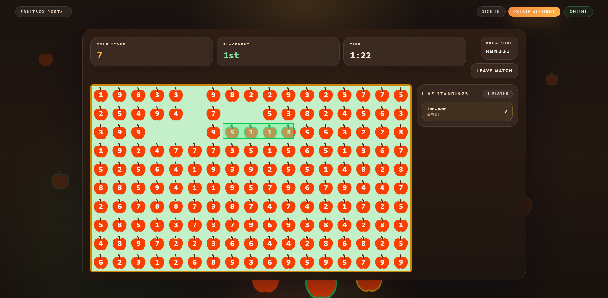

<a id="readme-top"></a>

<!-- PROJECT LOGO -->

<br />
<div align="center">
  <h1 align="center">Fruitbox Ranked</h1>

  <p align="center">
    Fast-paced multiplayer strategy game with real-time gameplay and competitive ranked matchmaking.
    <br />
    <br />
    <br />
    <br />
  </p>
</div>

---

## About the Project

**Fruitbox Ranked** is a full-stack multiplayer game platform built for competitive players. Experience real-time gameplay powered by **Socket.io**, climb the ranked ladder with our intelligent **matchmaking system**, and showcase your skills in both public matches and private rooms with friends.

Featuring secure authentication, persistent match history, and a sophisticated rating system, Fruitbox Ranked delivers the core infrastructure for a modern competitive gaming experience.

### Features

* **Real-time Multiplayer** using Socket.io WebSocket communication
* **Ranked Matchmaking System** with rating-based player progression
* **Private Game Rooms** for custom sessions with friends
* **User Authentication & Profiles** with match history and statistics
* **Interactive Game Board** with real-time state synchronization
* **Authenticated HTTP and Socket.IO APIs** with shared TypeScript event contracts

<p align="right">(<a href="#readme-top">back to top</a>)</p>



---

## Built With

The web and realtime services use:


<p align="right">(<a href="#readme-top">back to top</a>)</p>



---

## Offline Interview Demo

Use Node.js 22 LTS and run `npm ci` once while online if dependencies are missing. From this checkout, run:

```powershell
npm run demo:offline
```

Wait for Next.js to report `Ready` and for `fruitbox-realtime` to report that it is listening. Open [http://127.0.0.1:3400](http://127.0.0.1:3400) in a regular window and in a separate private window or browser profile. Both services bind to loopback, on ports `3400` and `3401`. Use that exact URL so the browser origin and auth configuration match. Press Ctrl+C in the terminal to stop both services.

The launcher builds a copy of the app with a dedicated Prisma SQLite client and stores data in the ignored `.offline-demo/prisma/demo.sqlite` file. The demo uses the same game engine, Socket.IO handlers, Better Auth flows, and rating calculations. Accounts and match history carry over between demo runs. Rehearse with throwaway local accounts and create two fresh accounts if you want to show a match starting at 1,000 Elo each. Assets, audio, and fonts are local. The Render wake endpoint targets the local Socket.IO health check during the demo.

### Interview run of show

1. Sign in with two local accounts. Open [the orchard seed](http://127.0.0.1:3400/?seed=orchard) in the host window and wait for **Online** in both windows. Choose **Create Private Room** on the host and **Join Private Room** on the other player. Enter the six-character code and show the `2/8` lobby count.
2. Start from the host window. Compare the opening boards after the five-second countdown. Drag over the first two apples in the top row (`4 + 6`) and point to the two-point update in the other window's standings.
3. Leave the private room from both windows. Choose **Find Ranked Match** in each. The first player waits, then the second enters and both receive the countdown. Score on one account and let the two-minute timer finish with different scores.
4. Select **Back To Home** in each window. Open the account menu and **Match History** to show the saved result. On fresh equal-rated accounts, a decisive match moves the winner to 1,016 and the loser to 984 Elo.
5. Choose **Find Casual Match** in both windows to show the separate queue. A completed casual win between equal-rated accounts moves hidden MMR by 12 points per player while visible Elo stays at its previous value.

For a short interview slot, run the private-room segment first and have a completed ranked match in the demo accounts' history. The [architecture walkthrough](docs/architecture.md) maps each step to the code and explains the design tradeoffs.

## PostgreSQL-backed development

Use Node.js 22 LTS and PostgreSQL. Run `npm ci`, copy `.env.example` to `.env`, and set `DATABASE_URL` and a unique `BETTER_AUTH_SECRET`. Run `npm run prisma:generate` and `npm run prisma:migrate` against the intended development database. Start `npm run dev` in one terminal and `node --env-file=.env --import tsx server/index.ts` in another, then open [http://localhost:3000](http://localhost:3000). The standalone Socket.IO process needs its environment loaded explicitly when developing from `.env`. A hosted process can use `npm run server:start` with variables supplied by its deployment environment.

### Available Commands

```bash
npm run dev              # Start Next.js frontend in dev mode
npm run server:dev      # Start game server with live reload
npm run server:start    # Start production game server
npm run build           # Build for production
npm run start           # Start production server
npm run demo:offline    # Build and start the loopback-only interview demo
npm run lint            # Run ESLint
npm run test            # Run test suite
npm run typecheck:server # Type-check server code
npm run prisma:generate # Generate Prisma client
npm run prisma:migrate  # Run database migrations
```

<p align="right">(<a href="#readme-top">back to top</a>)</p>

---

## Usage

1. **Sign up / Log in** with your username and password
2. **Join the Ranked Queue** to find opponents or **Create a Private Room** for friends
3. **Play in real-time** with live game state synchronization
4. **Check your stats** and climb the competitive ranking ladder
5. Your **match history** is saved automatically for future reference

---

## Project Structure

```
app/                    # Next.js frontend
├── api/               # REST API routes
├── auth/              # Authentication pages
└── profile/           # User profile pages

components/            # React components
├── auth/              # Auth UI components
├── game/              # Game UI and logic
└── menu/              # Navigation and menus

lib/                   # Shared utilities
├── auth.ts            # Auth configuration
├── game/              # Game engine logic
└── multiplayer/       # Real-time multiplayer code

server/                # Game server (Node.js)
├── matchmaking.ts     # Matchmaking service
├── room-registry.ts   # Room management
└── match-ratings.ts   # Ranking system

prisma/                # Database schema and migrations
tests/                 # Test suite
```

<p align="right">(<a href="#readme-top">back to top</a>)</p>

---

## Architecture Highlights

- **Separation of Concerns**: Frontend (Next.js) and backend (Node.js) run as separate services
- **Type Safety**: Full TypeScript coverage across frontend and backend
- **Real-time Sync**: Socket.io protocols define strict message contracts for game state
- **Process-local live state**: The room registry and queues live in one Socket.IO process. Multiple replicas would need explicit room ownership and queue coordination.
- **Database-First Design**: Prisma ORM with PostgreSQL for reliable data persistence

<p align="right">(<a href="#readme-top">back to top</a>)</p>
