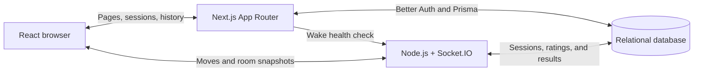

# Fruitbox Ranked interview walkthrough

> Fruitbox Ranked is a timed puzzle race. The web app handles accounts and history, a long-lived Socket.IO server runs the games and matchmaking, and a relational database stores player identity and results. Everyone starts with the same seeded board and competes on an individual copy.

| Component | Responsibility | Design rationale |
| --- | --- | --- |
| Next.js App Router and React | Serve the menu, account screens, and match history. Client components manage gestures, countdowns, and realtime updates. | Use HTTP for page and account requests and maintain persistent connections in a separately managed process. TypeScript shares contracts across both sides. |
| Socket.IO on Node.js | Authenticate connections, pair public players, manage private lobbies, validate moves, and broadcast updated room state. | A persistent bidirectional connection carries commands, acknowledgements, and server-initiated updates in one channel. Socket.IO rooms scope broadcasts to the match. |
| Shared TypeScript game engine | Generate seeded boards, resolve rectangle selections, score moves, and advance the clock. | Pure functions are easy to test. Reusing the rules keeps the browser preview aligned with server scoring. |
| Prisma and PostgreSQL | Store users, sessions, credential accounts, profiles, match records, and participants in the hosted setup. | Foreign keys and unique keys model user-to-match relationships. Prisma gives both services the same typed data access. PostgreSQL makes the two profile updates in a rating change atomic. |
| Local interview launcher | Build a loopback copy using a Prisma SQLite client and a separate demo database. | The two server roles and browser protocol stay the same. A local file removes the hosted database and network as live demo dependencies. PostgreSQL migrations and concurrency are separate verification concerns. |

## 1. Identity and connection

Better Auth uses its username plugin and password credentials. The signup form derives an internal email-shaped identifier from the username because it calls the email signup API. Better Auth stores the credential account, and its session cookie lets Next.js identify the requester. A `Profile` holds game-facing identity and separate ranked Elo and casual MMR, both initialized to 1,000. Keeping gameplay fields in a profile gives them their own lifecycle alongside auth records. Profile creation uses an upsert so concurrent first requests from the web and realtime services resolve the same record.

The browser requests `/api/realtime-auth` with its existing session cookie. The route resolves that cookie server-side and returns the current opaque session token with `Cache-Control: no-store`. The browser includes the token in the Socket.IO handshake. The realtime service looks up the token and checks its expiration, with Better Auth signed-cookie validation as a fallback. It assigns identity from the verified session and attaches the player ID and ratings to `socket.data`. That bridges independently hosted web and socket origins. The token is a bearer credential, so deployed origins should use TLS and keep it out of logs and persistent browser storage.

Read [auth configuration](../lib/auth.ts), [HTTP-to-socket handoff](../app/api/realtime-auth/route.ts), and [socket authentication](../server/auth.ts).

## 2. Matchmaking and room membership

Private rooms have a six-character code, a capacity of eight, and can start with one player. The room registry indexes rooms by ID, code, and player ID. The code uses a crypto-backed generator and omits ambiguous letters and digits. The host controls start and replay. A private replay keeps the lobby and creates a new match ID and seed. That gives players a convenient rematch while preserving the original database record.

Ranked and casual queues have independent entries indexed by user ID. The server scans on queue join and once per second. It takes the first mutually eligible pair in queue order. The rating gap has to fit both players' search windows, which widen every five seconds. A pair receives a two-player public room and starts automatically. Requiring both windows balances wait time with match quality, and the caps bound the largest allowed mismatch.

| Queue | Matching rating | Initial gap | Gap growth per 5 s | Maximum gap | Elo K-factor |
| --- | --- | ---: | ---: | ---: | ---: |
| Ranked | Visible Elo | 100 | 50 | 600 | 32 |
| Casual | Hidden MMR | 150 | 75 | 800 | 24 |

The wider casual search favors quicker access, while its smaller K-factor makes the hidden rating adjust more slowly. At equal ratings a decisive result is ±16 ranked or ±12 casual, with zero change for an equal-rating draw. Public matchmaking is head-to-head. If one slot is found stale before room creation, the service requeues any available player.

Read [matchmaking](../server/matchmaking.ts), [room registry](../server/room-registry.ts), and [rating math](../lib/ranks.ts).

## 3. Gameplay and synchronization

A match defaults to a 10×17 board, fruit values 1–9, a target sum of 10, a five-second countdown, and a two-minute play clock. The seed, board dimensions, and deterministic pseudorandom generator give every player the same opening layout. Individual boards let each player solve the puzzle independently. The seed is useful for reproducing the initial board during debugging. Replaying a full game would also require an ordered move record.

The browser translates a drag into a normalized rectangle so that the move means the same thing at different viewport sizes. The selected fruit are the cells whose centers lie in that rectangle. A valid move clears the selected fruit when they sum to 10 and awards one point per fruit. The browser previews the selection and applies an optimistic local update. It submits coordinates to the server, which checks membership and the active clock, evaluates the rectangle against that player's server-side board, and returns or broadcasts authoritative state. The client reconciles its display with that state. The server publishes timestamps so the browser can render a smooth timer locally between updates. High-frequency pointer movements stay on the client.

Room snapshots give every client a complete consistent view after a move. The tradeoff is payload size. Current snapshots include the boards of all room members, so an eight-player room costs more bandwidth per move. A larger deployment could send the submitting player their own board changes and publish only standings and lifecycle events to other players.

Read [game engine](../lib/game/), [room protocol](../lib/multiplayer/protocol.ts), [event handlers](../server/index.ts), and [game UI](../components/game/private-match-game.tsx).

## 4. Persistence and ratings

The realtime server keeps the live queue, rooms, and per-player boards in memory. It writes match and participant snapshots at lifecycle boundaries such as room creation, roster changes, start, and finish. Dragging fruit does not require a database write. `Match` stores the seed, configuration, timing, kind, and status. `MatchParticipant` stores the player snapshot, score, placement, and completion state. Compound uniqueness on `(matchId, userId)` supports upserts. The account menu reads up to 12 recent entries for the signed-in user. A completed match retains its final roster and standings as players leave the live room.

For an eligible finished public match, compare scores to determine win, draw, or loss. Elo uses `expected = 1 / (1 + 10^((opponentRating - rating) / 400))` and `delta = round(K × (actual - expected))`. A win for an underdog earns more because its expected score is lower. A decisive result gets at least a one-point change and ratings floor at zero. The same math runs for casual MMR against its own column. Private rounds and early departures do not change ratings. Both profile updates run in one Prisma transaction, and the process remembers finalized match IDs to guard against a duplicate application during its lifetime. Connected sockets receive the new ratings internally for their next queue attempt.

Read [schema](../prisma/schema.prisma), [snapshot writes](../server/persistence.ts), [rating writes](../server/match-ratings.ts), and [history query](../lib/profile.ts).

## 5. Deployment and scaling boundaries

The code supports a deployment with an independently hosted Next.js app and Socket.IO service. The checkout was configured against a Neon PostgreSQL endpoint. The repository includes a Render wake route that pings the realtime `/health` endpoint, and the browser can wait for the service before connecting. This helps a sleeping realtime instance start up, and the health endpoint confirms that the process is responding. Database readiness requires an actual auth or persistence check. The repository does not establish the public web hostname, current deployment status, or business metrics.

The current topology assumes one authoritative realtime process. Restarting it loses live queues and rooms while database-backed accounts, ratings, and written history survive. A disconnect can end a match and currently has no resume or rated-forfeit policy. Queue pairing can scan pairs quadratically when few players are compatible. To scale, assign each active room to one authoritative worker, coordinate matchmaking and cross-process fanout, and partition queues by rating or region as volume warrants. For stronger consistency, commit results, both ratings, and a unique rated-match record together in a transaction. That would move duplicate prevention out of process memory and make finalization retryable across restarts.

## Résumé claims to demonstrate

| Résumé claim | What to show or explain |
| --- | --- |
| Ranked and casual matchmaking, Elo and hidden MMR | Show both queues, complete a ranked game, and open the account menu to see visible Elo. The casual rating is stored in `Profile.casualMmr` and used by the casual queue. |
| Private rooms for up to eight players | Show a second player joining by code, lobby capacity, and both screens starting together. The server enforces the cap. |
| Accounts with Better Auth | Register or sign in with a local demo account, then open persisted match history. Explain the cookie-to-socket session exchange. |
| 250 active users and $500 revenue | Bring the original analytics and revenue evidence if asked. Define how you counted active users, the measurement period, and the revenue source. These metrics do not come from this source tree. |
| shadcn in the stack line | This checkout shows React components custom-styled with Tailwind. Present that implementation unless you can point to shadcn components in the version you shipped. |
